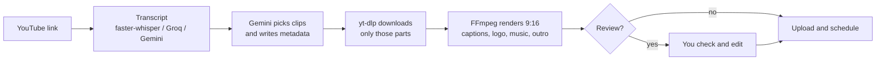

<div align="center">

# Clipper

**Paste a YouTube link. Get vertical Shorts with captions, ready to upload.**

An AI clipping tool that runs on your own device: Android (Termux), Linux, macOS and Windows.

[](LICENSE)


</div>

Clipper takes a YouTube video (or a live stream), finds the best moments with Google Gemini, cuts them out, renders
them as 9:16 videos with word-by-word captions, a logo, background music and an outro, writes the title, description
and hashtags, and can upload them to YouTube as scheduled private videos. You control everything from a web page that
runs on your own machine (`http://localhost:8000`), or from the command line.

## Contents

1. [What it does](#what-it-does)
2. [How it works](#how-it-works)
3. [What you need](#what-you-need)
4. [Install](#install): [Android (Termux)](#android-termux) · [Linux](#linux) · [macOS](#macos) · [Windows](#windows)
5. [Get your keys](#get-your-keys) (Gemini, Groq, YouTube)
6. [Configure](#configure)
7. [Run it](#run-it)
8. [Using the web app](#using-the-web-app)
9. [Command line](#command-line)
10. [Templates, captions and quality](#templates-captions-and-quality)
11. [Live streams](#live-streams)
12. [Optional extras](#optional-extras): face follow · local transcription · fonts · music and logo
13. [Settings reference](#settings-reference)
14. [Troubleshooting](#troubleshooting)
15. [Keeping your secrets safe](#keeping-your-secrets-safe)
16. [Update, back up, uninstall](#update-back-up-uninstall)
17. [Run on startup](#run-on-startup)
18. [Project layout](#project-layout) · [Tests](#tests) · [Limitations](#limitations)
19. [Responsible use](#responsible-use) · [License](#license) · [Credits](#credits)

---

## What it does

- **Finds the moments.** Gemini reads the real transcript and picks 15, 30, 45 or 60 second clips. Every start and end
  time is checked against the video and snapped to word boundaries, so clips begin and end on full sentences.
- **Four looks (templates).** Blurred background (default), white page with a tweet-style card, plain black, or
  full screen that follows the speaker's face.
- **Captions.** Word by word (karaoke style, five styles), one fixed line for the whole clip, or none. Works for
  English, Hindi (Devanagari) and Hinglish.
- **Polish.** Logo, background music that ducks under speech, loudness normalisation, optional silence removal, intro
  hook text, subscribe outro, crossfade.
- **Metadata.** Five title ideas, description, hashtags, hooks, cover text and category for each clip.
- **Upload and schedule.** Private upload with a publish time, retries, and several YouTube channels. Or review every
  clip first and upload only the ones you like.
- **Quality control.** Download at 360p, 480p, 720p or 1080p.
- **Live streams.** Paste a stream that is still running; it is saved up to that moment and clips are cut from it.
- **A real editor.** Edit titles, caption words, tweet text, name, handle and picture for each clip, then re-render.
  A live preview shows exactly what the renderer will produce.
- **Resumes after a crash.** Jobs are stored in a small database. If the app or phone stops, unfinished jobs continue
  on the next start.

## How it works



| Step | Runs where |
|---|---|
| Choosing clips, titles, descriptions, hashtags | Google Gemini API (it receives the **transcript text**, not your video) |
| Speech to text | Local faster-whisper if installed, otherwise Groq's free Whisper API, otherwise Gemini |
| Download, cut, render, captions | Your device (yt-dlp, FFmpeg) |
| Face follow | Your device (OpenCV, optional) |
| Upload | YouTube Data API |

No Docker, GPU or CUDA is needed.

## What you need

| | Minimum | Comfortable |
|---|---|---|
| **Python** | 3.10 | 3.12 or newer |
| **RAM free** | about 1 GB during a render (measured: FFmpeg peaks near 720 MB at 1080p) | 2 GB or more |
| **Storage free** | about 2 GB for tools and a few clips | 5 GB or more |
| **Internet** | Needed for Gemini, Groq, downloads and upload | |

Programs: **Python**, **FFmpeg** (must include the `ass` subtitle filter and libx264; standard builds do), **yt-dlp**,
and **git** to download the project.

Accounts and keys (all have free tiers):

| Key | Needed for | Required? |
|---|---|---|
| Gemini API key | Picking clips and writing metadata | **Yes** |
| Groq API key | Free, fast, accurate speech to text with word timing | Strongly recommended |
| Google Cloud OAuth client (`client_secret.json`) | Uploading to YouTube | Only if you want uploads |

Without YouTube credentials you can still make clips and download them.

Storage tips: each rendered clip is roughly 6 to 25 MB. A saved live stream can take 1 to 3 GB per hour, so pick a short
window for live streams and use Setup → Clean old working files now and then.

---

## Install

Pick your system. Each block can be copied and pasted line by line. When you finish, continue with
[Get your keys](#get-your-keys).

> The folder name matters only for the optional Termux boot script, which expects `~/clipper`. The commands below
> already clone into a folder called `clipper`.

### Android (Termux)

Install Termux from **F-Droid** or the **GitHub releases page** of Termux. The Play Store version is outdated and
will not work properly.

```bash
# 1. Update and install the basics
pkg update -y && pkg upgrade -y
pkg install -y python ffmpeg git

# 2. Let Termux read your phone storage (tap Allow). Needed only to import your own files.
termux-setup-storage

# 3. Download Clipper
git clone https://github.com/devrohit2007/Clipper.git clipper
cd clipper

# 4. Install the Python parts
pip install -U yt-dlp
pip install -r requirements.txt

# 5. Make your settings file and open it
cp .env.example .env
nano .env          # Ctrl+O then Enter to save, Ctrl+X to exit

# 6. Check that everything is found
python agent.py --check
```

Termux does not ship Hindi fonts. See [Fonts](#fonts) if you caption in Hindi.

Keep the phone awake while it works: `sh start.sh` takes a wake lock for you. Also switch off battery optimisation for
Termux in Android settings, or Android may stop it in the background.

### Linux

Debian, Ubuntu, Linux Mint:

```bash
sudo apt update
sudo apt install -y python3 python3-venv python3-pip ffmpeg git fonts-noto
```

Fedora (FFmpeg comes from RPM Fusion, see rpmfusion.org if `ffmpeg` is not found):

```bash
sudo dnf install -y python3 python3-pip git ffmpeg google-noto-sans-fonts
```

Arch:

```bash
sudo pacman -S --needed python python-pip ffmpeg git noto-fonts
```

Then, on any of them:

```bash
git clone https://github.com/devrohit2007/Clipper.git clipper
cd clipper

# A virtual environment keeps the packages out of your system Python (required on newer distributions)
python3 -m venv .venv
source .venv/bin/activate

pip install -U pip
pip install -U yt-dlp
pip install -r requirements.txt

cp .env.example .env
nano .env

python agent.py --check
```

Every time you open a new terminal, go to the folder and run `source .venv/bin/activate` before starting Clipper.

### macOS

Install [Homebrew](https://brew.sh) first if you do not have it, then:

```bash
brew install python ffmpeg git yt-dlp
brew install --cask font-noto-sans font-noto-sans-devanagari

git clone https://github.com/devrohit2007/Clipper.git clipper
cd clipper

python3 -m venv .venv
source .venv/bin/activate

pip install -U pip
pip install -r requirements.txt

cp .env.example .env
open -e .env       # opens the file in TextEdit

python agent.py --check
```

If `brew install yt-dlp` is used, you do not also need `pip install yt-dlp`. Update it with `brew upgrade yt-dlp`.

### Windows

Use **PowerShell** (Start menu, type "PowerShell"). The commands use `winget`, which comes with Windows 10 and 11.

```powershell
# 1. Install the programs. Close and reopen PowerShell afterwards so they are found.
winget install -e --id Python.Python.3.12
winget install -e --id Gyan.FFmpeg
winget install -e --id Git.Git

# 2. Download Clipper
git clone https://github.com/devrohit2007/Clipper.git clipper
cd clipper

# 3. Virtual environment
python -m venv .venv
.venv\Scripts\Activate.ps1

# 4. Install the Python parts
python -m pip install -U pip
python -m pip install -U yt-dlp
python -m pip install -r requirements.txt

# 5. Settings file
copy .env.example .env
notepad .env

# 6. Check
python agent.py --check
```

If `Activate.ps1` says scripts are disabled, run this once and try again:
`Set-ExecutionPolicy -Scope CurrentUser RemoteSigned`.
If `python` is not recognised, use `py` instead of `python`.
Windows has no `start.sh`; use `python server.py` (see [Run it](#run-it)).

For captions, the safest way on Windows is a fonts folder; see [Fonts](#fonts).

### Without git

On the repository page choose **Code → Download ZIP**, unzip it, and open a terminal inside the unzipped folder. Then
continue with the "virtual environment" step of your system (skip the `git clone` and `cd` lines).

### Reading the check report

`python agent.py --check` prints a list. `OK` is good, `MISS` is a required item that is missing, and `skip` is an
optional item you may not need.

```
[OK  ] ffmpeg
[OK  ] ffmpeg filter: ass
[MISS] GEMINI_API_KEY  (not set)
[skip] faster-whisper (local transcription)
```

Fix every `MISS` before running. `skip` lines are fine.

---

## Get your keys

Keys are private. They go only in the `.env` file on your machine, never in the code, never on GitHub.

### 1. Gemini API key (required)

1. Open <https://aistudio.google.com/apikey> and sign in.
2. Choose **Create API key** and copy it.
3. In `.env` set `GEMINI_API_KEY=` followed by the key, with no spaces or quotes.

The free tier is enough for normal use. If it runs out for the day, Clipper automatically tries the next model in
`GEMINI_MODELS`. Model names change often. Check <https://ai.google.dev/gemini-api/docs/deprecations> if you see
"model not found", and update `GEMINI_MODEL` and `GEMINI_MODELS` in `.env`.

### 2. Groq API key (recommended)

Groq gives free speech to text with exact word timing, which makes the word-by-word captions line up properly.

1. Open <https://console.groq.com>, create an account and go to **API Keys**.
2. Create a key and put it in `.env` as `GROQ_API_KEY=...`.

Without it, Clipper uses faster-whisper if you installed it, or the Gemini fallback, which only knows sentence times
(word timing is estimated, so karaoke captions are less exact).

### 3. YouTube upload access (only for uploading)

This is the longest step. You do it once.

1. Go to <https://console.cloud.google.com> and create a project (any name).
2. Open **APIs & Services → Library**, search **YouTube Data API v3** and click **Enable**.
3. Open **APIs & Services → OAuth consent screen** (also called Google Auth Platform).
   - User type: **External**.
   - Fill in the app name and your email.
   - On the **Test users** page add the Google account that owns your YouTube channel.
4. Open **APIs & Services → Credentials → Create credentials → OAuth client ID**.
   - Application type: **Desktop app**.
   - Download the JSON file.
5. Rename it to `client_secret.json` and put it in the Clipper folder (next to `agent.py`).
6. In `.env` make sure these lines say:
   ```
   YOUTUBE_CLIENT_SECRETS=client_secret.json
   YOUTUBE_TOKEN_FILE=token.json
   ```
7. Sign in:
   - **Web app:** open the **Accounts** screen and press **Sign in with Google**. Google opens, you approve, and you
     are returned to the app automatically.
   - **Command line:** run `python agent.py --auth`. It prints a Google link. Open it, approve, then copy the **whole
     address** the browser ends up on (that page fails to load, which is expected) and paste it into the terminal.

Good to know:

- While your Google Cloud app is in **Testing** mode, Google may expire the sign-in after about 7 days. If uploads
  start failing with `invalid_grant`, sign in again. To avoid it, set the app to **In production** on the consent
  screen (you can keep using it yourself; Google will show an "unverified app" warning that you can click through).
- Google limits API uploads per day. By default a project has 10,000 quota units and an upload costs about 1,600, so
  expect roughly 6 uploads a day. Check the YouTube API quota page for the current numbers.
- Videos uploaded by an API project that has not passed Google's audit can be forced to stay **private**. If your clips
  stay private after their publish time, this is the cause. You can publish them manually in YouTube Studio, or apply
  for Google's audit.
- Each YouTube channel has its own sign-in. Add more channels on the Accounts screen.

---

## Configure

Open `.env` in a text editor. Everything has a comment next to it. The lines you must check:

```ini
GEMINI_API_KEY=your-key-here
GROQ_API_KEY=your-groq-key-here
YOUTUBE_CLIENT_SECRETS=client_secret.json
YOUTUBE_TOKEN_FILE=token.json
```

Optional but useful:

```ini
MUSIC_FILE=~/music/track1.mp3        # background music, any mp3 or flac. Windows example: C:\Users\you\music\track1.mp3
LOGO_FILE=~/logo.png                 # your logo (also the picture on the tweet card)
CAPTION_FONTS_DIR=~/fonts            # folder with .ttf files (recommended everywhere, needed on Termux and Windows)
TWEET_NAME=Your Name
TWEET_HANDLE=@yourhandle
```

Notes:

- `~` means your home folder. On Windows write full paths, for example `C:\Users\you\logo.png`.
- No spaces around `=` and no quotes needed.
- Real environment variables override `.env`.
- Almost every setting can also be changed in the web app (**Style**). The order of priority is: built-in defaults,
  then `.env`, then what you saved in the web app, then choices you make for one video.
- API keys stay in `.env`. They are never shown in the browser and never stored in the database.

See the full [Settings reference](#settings-reference) below.

---

## Run it

Go to the Clipper folder, activate the virtual environment if you made one, and start the web app.

| System | Command |
|---|---|
| Termux | `sh start.sh` (keeps the phone awake) or `python server.py` |
| Linux / macOS | `source .venv/bin/activate` then `python server.py` |
| Windows | `.venv\Scripts\Activate.ps1` then `python server.py` |

Open **<http://localhost:8000>** in a browser on the same device. Leave the terminal open while it works.

Useful options:

```bash
python server.py --port 8080         # use another port
python server.py --set-password      # ask for a password in the browser
python server.py --clear-password    # remove the password
python server.py -v                  # more detailed log
```

### Use it from your phone or another computer on your Wi-Fi

By default only the device itself can open it. To allow others on your network:

```bash
python server.py --set-password
python server.py --host 0.0.0.0
```

Then set `CLIPPER_ALLOWED_HOSTS=192.168.1.20:8000` in `.env` (use your device's real address and port), and open that
address from the other device. It refuses to start on `0.0.0.0` without a password. It is plain HTTP, so use it only
on a network you trust.

---

## Using the web app

Five screens along the bottom (phone) or side (desktop).

**New clips**
1. Paste the YouTube link.
2. Choose **Review first** (clips wait for you) or **Upload automatically**.
3. Pick the look: template, captions (word by word, one line, off), language and style. A live preview shows the
   result. For the white tweet template, fill in the name, handle and picture.
4. Choose clip count, allowed lengths and download quality.
5. Press **Find clips**.

"Save these as my defaults" keeps your choices for next time. "More options" holds per-video extras: what kind of
moments to look for, visibility, ignoring saved results, and how much of a live stream to use.

**Clips**: every job with live progress and a full log. Open a job to see each rendered clip. For each one you can edit the
title, description, hashtags, category and publish time, the look of that clip (template, captions, tweet text, name,
handle, picture, caption text) and the caption words; then **Save**, **Re-render**, **Upload** or **Discard**.
**Re-render all clips** applies your current Style settings to every clip that is not uploaded yet.

**Style**: every setting, grouped: Look, Captions, Logo and end screen, Video quality, Audio, Clips, AI, Publishing,
Storage. It has a live preview made by the same renderer as the real clips, so what you save is what you get. You can
save presets and upload music, a logo and fonts.

**Accounts**: add YouTube channels and sign in to each.

**Setup**: a health check (Gemini, Groq, YouTube, FFmpeg, yt-dlp, fonts, disk space), password, clean-up of old temporary
files, and light or dark theme.

How it behaves:

- Jobs run one at a time. A long video can take many minutes on a phone.
- Cancel stops the running download or render within moments.
- If the app is stopped or the device restarts, unfinished jobs resume on the next start.
- The clip file is deleted from your device only after YouTube confirms the upload.

---

## Command line

The command line does the same work without the web page.

```bash
python agent.py                        # asks for a link
python agent.py URL                    # make clips and upload them
python agent.py URL --style neon --clips 3 --srt
python agent.py URL --durations 30,45  # allowed clip lengths
python agent.py URL --review           # ask before each upload
python agent.py URL --no-upload        # render only, never upload
python agent.py URL --fresh            # ignore the saved transcript and plan for this video
python agent.py --check                # dependency report
python agent.py --auth                 # YouTube sign-in only
```

Caption styles: `karaoke`, `bold`, `minimal`, `neon`, `podcast`.
Finished clips are in `output/clips/`. Job state is in `output/jobs/`.

---

## Templates, captions and quality

**Templates**

| Template | What you get |
|---|---|
| Blurred (default) | The video fills the 9:16 screen, with a blurred copy behind when needed. |
| White + tweet | White page, the video fitted in the middle (never cropped), and a tweet-style card above its top-left corner: round picture, name, handle and the clip title as the text. |
| Black | The video fitted on black; your logo stays in the corner. |
| Face follow | Full screen, no blur, no bars. A vertical strip of the video follows the speaker's face (needs OpenCV, see [Face follow](#face-follow)). If no face is found it crops the centre. |

On the white template the logo becomes the card picture and captions switch to dark text with a blue highlight so they
read well on white (unless you chose your own colours).

The tweet card is a look-alike layout drawn by this app. It is not X's real interface and has no verified badge. Use
your own name and picture.

**Captions**: Off, Word by word (follows the speech), or One line (a fixed text for the whole clip, by default the
generated cover text; edit it for each clip). Caption language can be As spoken, Hindi (Devanagari), English or
Hinglish.

**Download quality**: 360p, 480p, 720p or 1080p is the highest quality fetched. Lower is faster and uses less data.
If a video has no stream that small, the next best is used.

---

## Live streams

Paste the link of a stream that is **still running**. Clipper saves the part you choose (last 15 min, 30 min, 1 hour,
2 hours, or everything available up to 4 hours; default 1 hour) up to that moment, stops there, and cuts clips from the
saved recording. Re-render works from the same recording.

- A stream that has not started, or just ended and is still being processed by YouTube, is refused with a message.
- The saved recording stays until you clean up temporary files. If it is deleted, start a new job from the finished video.
- Only streams that offer one combined video and audio HLS stream are supported (YouTube live does).
- This has been tested with a simulated stream, not a real YouTube one.

---

## Optional extras

### Face follow

Needs OpenCV.

- **Termux:**
  ```bash
  pkg install x11-repo
  pkg install opencv-python python-numpy
  python -c "import cv2; print(cv2.__version__)"
  ```
  Do not use `pip install opencv-python` on Termux. The Termux build has no bundled detector data; Clipper finds the
  file in `$PREFIX/share/opencv5/haarcascades` automatically.
- **Linux, macOS, Windows:** `pip install opencv-python-headless`

Then choose the **Face follow** template, or turn on face tracking with "Crop" framing in Style. The detector finds
front-facing faces. If none is found, the centre is used.

### Local transcription (no Groq)

`pip install faster-whisper` transcribes on your own device with no key. It needs more RAM and storage, and may not
install on Termux. Choose the size with `WHISPER_MODEL=base` (or `small`, `medium`). To make Gemini never do
transcription, set `TRANSCRIBE_ENGINE=groq` or `local`.

### Fonts

Captions use the fonts named in `.env`: `CAPTION_FONT=Noto Sans` and `CAPTION_FONT_HINDI=Noto Sans Devanagari`.
If you see empty boxes instead of Hindi letters, the font is missing.

1. Download **Noto Sans** and **Noto Sans Devanagari** from <https://fonts.google.com/noto>.
2. Put the `.ttf` files in a folder, for example `~/fonts`.
3. Set `CAPTION_FONTS_DIR=~/fonts` in `.env` (on Windows, a full path such as `C:\Users\you\fonts`).
4. Make sure the font names in `.env` are the fonts' family names.

You can also upload fonts on the Style screen.

### Music and logo

Put an mp3 or flac in `MUSIC_FILE` and a PNG in `LOGO_FILE`, or upload them on the Style screen. Music is lowered under
speech automatically.

---

## Settings reference

Every item can be set in `.env`. Most can also be changed on the Style screen. Full comments are in `.env.example`.

| Setting | Default | What it does |
|---|---|---|
| `GEMINI_API_KEY` | | Required. Picks clips and writes metadata. |
| `GEMINI_MODEL`, `GEMINI_MODELS` | see file | First model to try, then the fallback chain. |
| `GROQ_API_KEY`, `GROQ_MODELS` | | Free cloud transcription. |
| `TRANSCRIBE_ENGINE` | `auto` | `auto` (faster-whisper, then Groq, then Gemini), `local`, `groq`, `gemini`. |
| `WHISPER_MODEL`, `WHISPER_LANGUAGE` | `base`, auto | Local transcription size and language. |
| `YOUTUBE_CLIENT_SECRETS`, `YOUTUBE_TOKEN_FILE` | `client_secret.json`, `token.json` | YouTube sign-in files. |
| `OUTPUT_DIR`, `TEMP_DIR`, `DATA_DIR` | `output`, `output/tmp`, `data` | Where files are kept. |
| `CLIP_COUNT`, `CLIP_DURATIONS` | `3`, `15,30,45,60` | How many clips and allowed lengths in seconds. |
| `TEMPLATE` | `blur` | `blur`, `tweet`, `black`, `face`. |
| `TWEET_NAME`, `TWEET_HANDLE`, `TWEET_AVATAR` | empty | Tweet card identity; avatar falls back to `LOGO_FILE`. |
| `CAPTION_ENABLED`, `CAPTION_MODE` | `true`, `words` | Captions on or off; `words` or `single`. |
| `CAPTION_STYLE` | `karaoke` | `karaoke`, `bold`, `minimal`, `neon`, `podcast`. |
| `CAPTION_FONT`, `CAPTION_FONT_HINDI`, `CAPTION_FONTS_DIR` | Noto Sans | Fonts. |
| `MAX_HEIGHT` | `1080` | Download quality ceiling: 360, 480, 720 or 1080. |
| `FIT_MODE`, `FACE_TRACKING`, `ZOOM` | `auto`, `true`, `0.06` | Framing on the blurred template. |
| `LOGO_SIZE`, `INTRO_HOOK`, `OUTRO_ENABLED`, `OUTRO_LINES`, `TRANSITION_SEC` | | Logo, intro text, outro and crossfade. |
| `MUSIC_VOLUME`, `DUCK_MUSIC`, `NORMALIZE_AUDIO` | `0.15`, `true`, `true` | Audio. |
| `REMOVE_SILENCE`, `SILENCE_DB`, `SILENCE_MIN_SEC` | `false`, `-35`, `0.7` | Cut long pauses. |
| `LIVE_MINUTES` | `60` | Live streams: how much to save (0 = everything available). |
| `AUTO_UPLOAD`, `REVIEW_MODE` | `true`, `false` | Upload automatically, or ask first. |
| `PUBLISH_START_DELAY_MIN`, `PUBLISH_INTERVAL_HOURS` | `20`, `3` | When the first clip goes public and the gap between clips. |
| `UPLOAD_RETRIES` | `5` | Retries on network errors. |
| `CLIPPER_ALLOWED_HOSTS` | | Extra host names for network access. |

---

## Troubleshooting

Start with `python agent.py --check`, or the **Setup** screen in the web app. The job **log** on the Clips screen shows
what went wrong, with secrets hidden.

| Problem | Cause and fix |
|---|---|
| `'ffmpeg' not found` or `'yt-dlp' not found` | The program is not on your PATH. Install it (see [Install](#install)), then **close and reopen the terminal**. On Windows, reopen PowerShell after `winget`. |
| `[MISS] ffmpeg filter: ass` | Your FFmpeg was built without subtitle support. Use a full build: `winget install Gyan.FFmpeg` (Windows), `brew install ffmpeg` (macOS), `apt install ffmpeg` (Linux), `pkg install ffmpeg` (Termux). |
| `GEMINI_API_KEY is not set` | Put the key in `.env`, save, and restart. Check there are no spaces or quotes. |
| Gemini error 429, "quota" or "rate limit" | Free limits reached. Clipper already tries the next model and waits. Try later, or add more models to `GEMINI_MODELS`. |
| `model not found` (404) | The model was retired. Check <https://ai.google.dev/gemini-api/docs/deprecations> and update `GEMINI_MODEL(S)`. |
| Downloads fail, HTTP 403, "Sign in to confirm you're not a bot", or "unable to extract" | YouTube changed something. Update the downloader: `pip install -U yt-dlp` (or `brew upgrade yt-dlp`). Then retry the job. |
| "This is a live stream that has not ended" / "has not started yet" / "just ended" | See [Live streams](#live-streams). Wait for it to finish processing, or paste a link to a stream that is running. |
| `Address already in use` | Another program uses port 8000. Start with `python server.py --port 8080`. |
| Browser shows "invalid Host header" or a 403 error | Open it as `http://localhost:8000`. For another device see [Use it from your phone or another computer](#use-it-from-your-phone-or-another-computer-on-your-wi-fi). |
| `pip` says `externally-managed-environment` | Use a virtual environment: `python3 -m venv .venv`, activate it, and install there. |
| PowerShell says running scripts is disabled | `Set-ExecutionPolicy -Scope CurrentUser RemoteSigned`, then activate the environment again. |
| `python` not found on Windows | Use `py`, or reinstall Python and tick **Add python.exe to PATH**. |
| `redirect_uri_mismatch` when signing in | The OAuth client must be of type **Desktop app**. Create a new one and replace `client_secret.json`. |
| `access_denied` or "app not verified / not allowed" | Add your Google account under **Test users** on the OAuth consent screen. |
| `invalid_grant` or uploads suddenly ask you to sign in again | The sign-in expired (7 days while the Cloud app is in Testing). Sign in again on the Accounts screen, or set the app to **In production**. |
| `quotaExceeded` on upload | Daily YouTube API quota is used up. Wait until the next day (Pacific time). |
| Uploaded clips stay private | Unaudited API projects can be locked to private. Publish in YouTube Studio, or apply for Google's audit. |
| Hindi shows as empty boxes | Missing font. See [Fonts](#fonts). |
| Captions look off-time | Without Groq or faster-whisper, word timing is estimated. Add a Groq key. |
| `Killed`, `Cannot allocate memory`, or the job stops on a phone | Not enough RAM. Close other apps, lower **Download quality** to 720p or 480p, and keep Termux awake (`sh start.sh`, disable battery optimisation). |
| `No face found (or OpenCV missing)` | Face follow needs OpenCV; see [Face follow](#face-follow). It crops the centre in the meantime. |
| `The saved recording of this live stream was deleted` | Temporary files were cleaned up. Start a new job from the finished video. |
| `No space left on device` | Open **Setup → Clean old working files**, delete old files in `output/`, or lower quality and live-stream length. |
| The preview looks fine but a clip looks different | Press **Re-render** on the clip. Existing clips pick up new Style settings only when re-rendered. |
| A job failed halfway | Open it and press **Try again**. Finished work (transcript, plan, downloaded parts) is reused. |

Still stuck? Run `python server.py -v`, repeat the problem, and open an issue with the job log (it hides your keys, but
look it over before posting).

---

## Keeping your secrets safe

These files are private. The included `.gitignore` already keeps them out of git:

| File or folder | Contains |
|---|---|
| `.env` | Your API keys |
| `client_secret.json` | Your Google OAuth client |
| `token.json`, `data/` | Your YouTube sign-in and the web app database |
| `output/` | Clips and job files |

Before you push your own changes to GitHub, check that nothing private is included:

```bash
git status                       # these files must not be listed
git check-ignore -v .env token.json client_secret.json data
```

If a key was ever committed or posted anywhere, treat it as leaked: delete it in Google AI Studio, Groq or Google
Cloud and create a new one. Deleting the file in a later commit does not remove it from git history.

How the app protects you: the web app listens only on your own device, rejects unexpected Host headers, requires a
custom header on every change so other websites cannot control it, uses an HttpOnly session cookie when a password is
set, rate-limits password attempts, serves clips only from `output/clips`, and removes secrets from logs. The password is a
local lock, not a replacement for network security. The app is plain HTTP.

---

## Update, back up, uninstall

**Update**

```bash
cd clipper
git pull
pip install -r requirements.txt
pip install -U yt-dlp            # do this often; YouTube changes break old versions
```

**Back up**: copy `.env`, `client_secret.json`, `token.json` and the `data/` folder somewhere safe. That is everything
that is yours.

**Uninstall**: delete the `clipper` folder. Optionally remove the app's access in your Google account under
Security → Third-party access.

---

## Run on startup

- **Termux:** install the **Termux:Boot** app, open it once, then
  ```bash
  mkdir -p ~/.termux/boot
  cp termux-boot/start-clipper.sh ~/.termux/boot/
  ```
  The script expects the project in `~/clipper`. Edit `CLIPPER_DIR` inside it if yours is elsewhere. Its log is
  `data/boot.log`.
- **Linux (systemd, per user):** create `~/.config/systemd/user/clipper.service`:
  ```ini
  [Unit]
  Description=Clipper

  [Service]
  WorkingDirectory=%h/clipper
  ExecStart=%h/clipper/.venv/bin/python server.py
  Restart=on-failure

  [Install]
  WantedBy=default.target
  ```
  Then `systemctl --user daemon-reload && systemctl --user enable --now clipper`.
- **macOS and Windows:** run `python server.py` yourself, or add it to Login Items or Task Scheduler.

---

## Project layout

```
agent.py            command line entry point
server.py           web app entry point
start.sh            starts the web app (keeps Termux awake)
requirements.txt    Python packages
.env.example        every setting, commented
modules/            the code: pipeline, video_editor, captions, templates,
                    transcription, ai_analyzer, clip_selector, content_generator,
                    youtube_uploader, scheduling, store, settings, webapp, utilities
ui/                 the web app (plain HTML, CSS, JavaScript; no build step)
termux-boot/        optional start-on-boot script for Termux
tests/              automated tests
```

---

## Tests

```bash
pip install pytest
python -m pytest tests -q
```

The suite uses real FFmpeg renders on synthetic video and checks pixels (templates, captions, logo), the web server
(security, passwords, range streaming, job queue, restart recovery), the full path from web API to rendered, uploaded
clip with a stand-in `yt-dlp`, and that every Style setting changes the rendered output (`tests/test_style_parity.py`).
It takes several minutes. Tests that need FFmpeg's `ass` filter are skipped if it is missing.

---

## Limitations

- Gemini, Groq, YouTube upload, real `yt-dlp` downloads and faster-whisper are covered by tests with stand-ins, not by
  live calls in the automated tests. Report anything that breaks against the real services.
- Live streams were tested with a simulated stream only.
- Face follow uses OpenCV's front-face detector, so turned or very small faces can be missed.
- Hinglish transcription quality depends on the speech engine and model size. Hindi to English caption translation works
  per phrase, so word timing inside a phrase is approximate.
- Speaker labels (for the podcast style) need speaker detection, which is not included.
- Hashtags come from the transcript, not from trend data.
- One job runs at a time.
- The web app has been checked in desktop Chromium at phone width, not on every phone browser.
- The tweet card shows at most four lines; longer titles end with "…". Vertical source videos are shrunk to fit inside the
  white and black templates.

---

## Responsible use

Only clip videos you own or have clear permission to reuse. Respect copyright, the YouTube Terms of Service and the
YouTube API Services Terms, and do not use this to re-upload other people's work without permission. Disclose edited or
AI-assisted content where platforms require it. You are responsible for what you upload.

## License

Released under the [MIT License](LICENSE).

## Credits

Built on excellent open-source and free tools: [FFmpeg](https://ffmpeg.org), [yt-dlp](https://github.com/yt-dlp/yt-dlp),
[faster-whisper](https://github.com/SYSTRAN/faster-whisper), [OpenCV](https://opencv.org), the Google API client
libraries, [Google Gemini](https://ai.google.dev) and [Groq](https://groq.com).
